# CinemaUQ — Documento final (Entrega 3)

Programación II · Universidad del Quindío · 2026-2

| | |
|---|---|
| Integrantes | Andrés David Santafé López · Juan Diego Quitián Rengifo · Juan Carlos Polanía Hincapié |
| Repositorio | https://github.com/JuanDQDev/CinemaUQ |
| Docente | Carolina Londoño Idarraga |
| Fecha | 15 de noviembre de 2026 |
| Tecnología | Java, JavaFX (FXML + CSS), Maven, JUnit 5 |
| Diagrama de clases | [`Diagrama de clases CinemaUQ Entrega 3.pdf`](Diagrama%20de%20clases%20CinemaUQ%20Entrega%203.pdf) · editable en [`.drawio`](Diagrama%20de%20clases%20CinemaUQ%20Entrega%203.drawio) |
| Base del documento | [`Taller integracion de patrones.md`](Taller%20integracion%20de%20patrones.md) (11 de noviembre) |

## 1. Qué hace la aplicación

CinemaUQ gestiona un cine con dos perfiles.

- **Cliente:**
  - se registra e ingresa;
  - consulta la cartelera, elige función y asientos en el mapa de la sala, y agrega confitería;
  - paga con su tarjeta virtual y, si quiere, con puntos;
  - consulta sus compras, su saldo, sus movimientos y sus puntos;
  - cancela compras y solicita recargas.
- **Administrador:**
  - gestiona tarifas, películas, salas, funciones, confitería y promociones;
  - cancela funciones;
  - consulta clientes y compras;
  - aprueba o rechaza recargas;
  - genera reportes exportables y ve los reportes visuales.

### Usuarios de prueba

La aplicación arranca con datos de demostración (`service/DatosDemostracion`).

| Perfil | Identificación | Contraseña | Para probar |
|---|---|---|---|
| Administrador | `A01` (o `admin`) | `Admin123` | Todo el panel; hay una solicitud de recarga pendiente |
| Cliente | `1001` | `Demo123` | Compra completa: tiene saldo de $200.000 y puntos para redimir |
| Cliente | `laura` | `Laura123` | Puntos vencidos (compró hace 13 meses) y una compra cancelada |
| Cliente (16 años) | `mateo` | `Mateo123` | Restricción de edad: no puede comprar *Echoes* (+18) |
| Cliente | `sara` | `Sara1234` | Solicitud de recarga aprobada |
| Clientes | `valentina`, `camilo`, `daniela`, `gloria` | `Valentina123`, `Camilo123`, `Daniela123`, `Gloria123` | Historial de compras |

Un cliente nuevo también se puede registrar desde la pantalla de acceso y recibe un bono de bienvenida de $50.000.

### Cómo ejecutar

- **Aplicación:** en IntelliJ, ejecutar `Launcher`; o `mvnw javafx:run`.
- **Pruebas:** clic derecho sobre `src/test/java` → *Run 'All Tests'* (53 pruebas).

## 2. Arquitectura (MVC)

```
vista (FXML + CSS) → controller → CinemaFacade / SistemaCinema → servicios → model
```

| Paquete | Contenido |
|---|---|
| `model` | Dominio: películas, salas, funciones, clientes, tarjeta, compra y sus estados, puntos, confitería, entradas, políticas de reembolso, `EstadisticasCine` |
| `service` | `SistemaCinema` (datos y sesión), `CinemaFacade` (acceso del cliente), `ServicioCompra`, `ServicioReportes`, exportadores, `DatosDemostracion`, `MedioPago` y su adaptador |
| `controller` | Un controlador por vista. `NavegadorSesion` cambia entre acceso, cliente y administrador |
| `exception` | Excepciones propias del dominio |

## 3. Requisitos de la entrega 3

| Exigencia | Dónde está |
|---|---|
| Programa de puntos con vigencia y redención | Sección 5 · `MontoPuntos`, `LotePuntos`, `RedencionPuntos` |
| Políticas de cancelación y reembolso | Sección 4 · State + Strategy |
| Reportes exportables (.txt) | Sección 8 · `ServicioReportes`, `ExportadorReporteTxt` |
| Reportes visuales (barras, pastel, líneas) | Sección 8 · `EstadisticasCine`, `ReportesAdminController` |
| Estadísticas de operación | `EstadisticasCine` → `ResumenEstadistico` |
| Datos iniciales suficientes | Sección 9 · `DatosDemostracion` |
| Al menos 3 patrones de comportamiento | Observer, Strategy y State (sección 6) |
| Los 10 patrones y evidencia SOLID | Secciones 6 y 7 |

## 4. Política de cancelación y reembolso

**Regla (enunciado):** si faltan más de 24 horas para la función, se devuelve el 100 %; entre 2 y 24 horas, el 80 %; con menos de 2 horas no se puede cancelar. Si el cine cancela la función, se devuelve el 100 %. El dinero vuelve a la misma tarjeta y una compra nunca se reembolsa dos veces.

**Cómo funciona en el código**, paso a paso:

1. El cliente pulsa *Cancelar* en *Mis compras*. `CinemaFacade.calcularReembolso(compra)` le muestra cuánto recibirá antes de confirmar.
2. `ServicioCompra.procesarReembolso(compra, hora)` hace dos cosas:
   - **State:** `compra.validarCancelacion(hora)` delega en el estado actual. `CompraConfirmada` rechaza si la función ya empezó o faltan menos de 2 horas. `CompraCancelada` rechaza siempre: así una compra no se reembolsa dos veces.
   - **Strategy:** elige la política según el tiempo restante (`ReembolsoCien` si faltan más de 24 horas, `ReembolsoOchenta` si no) y le pide el valor con `calcularReembolso(total)`.
3. `ServicioCompra.cancelarCompra` ejecuta la cancelación en este orden:
   1. devuelve el dinero a la tarjeta (`TarjetaVirtual.reembolsar`, que deja el movimiento `REEMBOLSO` con la factura como referencia);
   2. libera los asientos;
   3. pasa la compra al estado `CompraCancelada` y guarda el monto, la fecha y el motivo;
   4. anula los puntos que generó esa compra y devuelve los puntos que se usaron en ella.
4. `CinemaFacade.cancelarCompra(compra, montoConfirmado)` compara el monto que vio el cliente con el actual. Si el plazo cambió mientras decidía (pasó de 100 % a 80 %), no cancela y le pide confirmar de nuevo.

**Cuando cancela el cine:** `SistemaCinema.cancelarFuncion(funcion)` valida primero todos los reembolsos y luego llama a `ServicioCompra.cancelarPorCine(compra)` por cada compra. Se devuelve el 100 % aunque falten menos de 2 horas, porque el estado usa `cancelarPorCine()` y no la validación del plazo.

`SinReembolso` (0 %) existe como tercera política para una regla que retenga todo el valor. Hoy no se usa, porque con menos de 2 horas la cancelación se rechaza antes.

**Pruebas:** `SistemaCinemaTest.plazosExactosUsanStateYStrategy`, `cineCancelaFuncionAlCienInclusoDentroDeDosHoras`, `cancelarFuncionNoDuplicaReembolsoDeCompraYaCancelada`, `noCancelaSiElMontoConfirmadoNoCoincide`.

## 5. Programa de puntos

| Regla | Valor | Dónde |
|---|---|---|
| Acumulación | 10 % de lo pagado con la tarjeta en cada compra | `MontoPuntos.acumularPuntos` (`PORCENTAJE_ACUMULACION`) |
| Equivalencia | 1 punto = $1 | `ServicioCompra.calcularValorPuntos` |
| Vigencia | 1 año desde la fecha de la compra | `LotePuntos.getFechaVencimiento`, `estaVencido` |
| Qué se redime | Entradas, productos o combos **completos** del carrito | `ServicioCompra.comprar` |
| Orden de uso | Primero los puntos más próximos a vencer | `MontoPuntos.redimir` |
| Control | No se usan puntos vencidos ni más de los disponibles | `PuntosInsuficientesException` |

**Acumulación.** Para respetar la responsabilidad única hay dos clases: `MontoPuntos` es la cuenta de puntos del cliente y `LotePuntos` es cada acumulación, con su cantidad, su fecha, la factura que la generó y su vencimiento. Al confirmar una compra, `ServicioCompra` llama a `acumularPuntos(total, factura, fecha)`, que crea un lote con el 10 % del total.

**Gasto (redención).** En la pantalla de pago el cliente elige cuántas entradas y qué productos paga con puntos. Entonces:

1. `ServicioCompra` calcula el valor de esos artículos (`calcularValorPuntos`) y verifica que estén en el carrito y que el cliente tenga puntos vigentes suficientes. Si no, lanza `PuntosInsuficientesException` y no cobra nada.
2. Cobra a la tarjeta solo la diferencia. `Compra.getTotal()` es lo pagado con la tarjeta y `Compra.getPuntosRedimidos()`, lo pagado con puntos.
3. `MontoPuntos.redimir` ordena los lotes por fecha de vencimiento y descuenta primero de los que vencen antes. Guarda una `RedencionPuntos` con la fecha, la factura y de qué lotes salió cada punto.
4. La compra acumula puntos nuevos solo sobre lo pagado con la tarjeta.

**Cancelación.** Los puntos que generó la compra se anulan (`anularPorCompra`) y los que se usaron vuelven a sus lotes (`devolverPorCompra`).

**Consulta.** El cliente ve sus puntos en *Mi tarjeta* → *Ver mis puntos*: cada acumulación con su vencimiento y cada redención. El administrador los ve en *Clientes y recargas* y en el reporte de puntos.

**Pruebas** (`PuntosYReportesTest`): `seRedimenPrimeroLosPuntosMasProximosAVencer`, `losPuntosVencidosNoSePuedenUsar`, `pagarUnaEntradaConPuntosDescuentaPuntosYCobraElResto`, `sinPuntosSuficientesNoSeCompraNiSeCobra`, `soloSeRedimeLoQueEstaEnElCarrito`, `cancelarDevuelveLosPuntosUsadosYAnulaLosGanados`.

## 6. Patrones de diseño

Los 10 patrones exigidos: 3 creacionales, 4 estructurales y 3 de comportamiento. La columna de consecuencias es la del taller.

| Tipo | Patrón | Clases | Página del diagrama de clases |
|---|---|---|---|
| Creacional | Singleton | `ConsecutivoFactura` | 03 · Clientes y compras |
| Creacional | Builder | `Funcion.Builder` | 02 · Cartelera y salas |
| Creacional | Prototype | `Clonable`, `Sala`, `Asiento` | 02 · Cartelera y salas |
| Estructural | Adapter | `MedioPago`, `AdaptadorTarjetaVirtual`, `TarjetaVirtual` | 05 · Adapter y Facade |
| Estructural | Composite | `ElementoProducto`, `Producto`, `Combo` | 04 · Composite y Decorator |
| Estructural | Decorator | `Entrada`, `EntradaBase`, `EntradaDecorator`, `LenteTresDDecorator`, `PantallaIMAXDecorator` | 04 · Composite y Decorator |
| Estructural | Facade | `CinemaFacade` | 05 · Adapter y Facade |
| Comportamiento | Observer | `ObservadorSaldo`, `TarjetaVirtual`, `ContextoAplicacion` | 10 · Observer y saldo |
| Comportamiento | Strategy | `IPoliticaReembolso`, `ReembolsoCien`, `ReembolsoOchenta`, `SinReembolso`, `ServicioCompra` | 09 · Cancelación, State y Strategy |
| Comportamiento | State | `EstadoCompra`, `CompraConfirmada`, `CompraCancelada`, `Compra` | 09 · Cancelación, State y Strategy |

No usamos Abstract Factory, Factory Method, Proxy, Command ni Mediator.

**Cómo trabajan juntos en una compra** (parte B del taller):

| Paso | Clases | Qué pasa | Patrón |
|---|---|---|---|
| 1 | `CarteleraController`, `CinemaFacade`, `ServicioCompra`, decoradores | El cliente elige la función y se muestra el precio de la entrada según el formato de la sala | Facade, Decorator |
| 2 | `CarritoCompra`, `AsientosController`, `Sala`, `Asiento` | Elige asientos en el mapa de la copia de sala de esa función | Prototype |
| 3 | `ConfiteriaController`, `Producto`, `Combo` | Agrega productos y combos; todos se suman con `calcularPrecio()` | Composite |
| 4 | `PagoController`, `CinemaFacade` | Elige qué paga con puntos y confirma | Facade |
| 5 | `ServicioCompra` | Valida edad, horario, asientos y puntos | |
| 6 | `ConsecutivoFactura`, `AdaptadorTarjetaVirtual`, `TarjetaVirtual` | Genera la factura y cobra a la tarjeta | Singleton, Adapter |
| 7 | `TarjetaVirtual`, `ContextoAplicacion` | El saldo de la barra se actualiza solo | Observer |
| 8 | `MontoPuntos`, `Compra` | Redime y acumula puntos; la compra nace en estado `CompraConfirmada` | State |
| 9 | `ServicioCompra`, políticas de reembolso | Si el cliente cancela, el estado valida y la política calcula el reembolso | State, Strategy |

### 6.1 Singleton
- **Problema:** debe existir un único generador del consecutivo de factura, para que no se repitan (RN-014).
- **Justificación:** todas las compras piden el número a la misma instancia (`ConsecutivoFactura.getInstance()`), así que la secuencia `FAC-000001`, `FAC-000002`… es común a toda la aplicación.
- **Clases:** `model.ConsecutivoFactura`.
- **Consecuencia:** el contador vive en memoria y vuelve a 1 al reiniciar. Su estado se comparte entre pruebas de la misma JVM.
- **Evidencia:** `ConsecutivoFacturaTest` · ficha en [`Patron Singleton.md`](Patron%20Singleton.md).

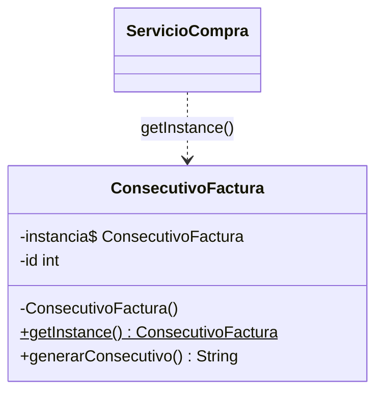

### 6.2 Builder
- **Problema:** una función reúne cinco datos obligatorios (identificador, fecha y hora, idioma, película y sala) que deben validarse antes de crearla (RN-001).
- **Justificación:** `Funcion.Builder` recibe los datos por pasos y `build()` no entrega la función si falta alguno. `Funcion` queda sin constructor público y sin setters para esos campos.
- **Clases:** `model.Funcion`, `model.Funcion.Builder`. Lo usa `SistemaCinema.guardarFuncion`.
- **Consecuencia:** los campos se declaran dos veces (en `Funcion` y en `Builder`). Los datos faltantes se detectan al ejecutar `build()`, no al compilar.
- **Evidencia:** `FuncionBuilderTest` · ficha en [`Patron Builder.md`](Patron%20Builder.md).

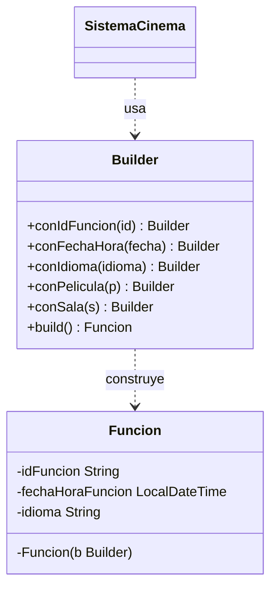

### 6.3 Prototype
- **Problema:** cada función necesita su propia copia de los asientos de la sala, con disponibilidad independiente (RN-002).
- **Justificación:** la sala registrada es una plantilla. Al programar una función se llama a `sala.clonar()`, que copia la sala y cada asiento. Vender un asiento en una función no lo ocupa en las demás.
- **Clases:** `model.Clonable<T>`, `model.Sala`, `model.Asiento`.
- **Consecuencia:** cada función guarda una copia de todos los asientos. Clonar una plantilla ocupada también copiaría ese estado.
- **Evidencia:** `SalaPrototypeTest` · ficha en [`Patron Prototype.md`](Patron%20Prototype.md).

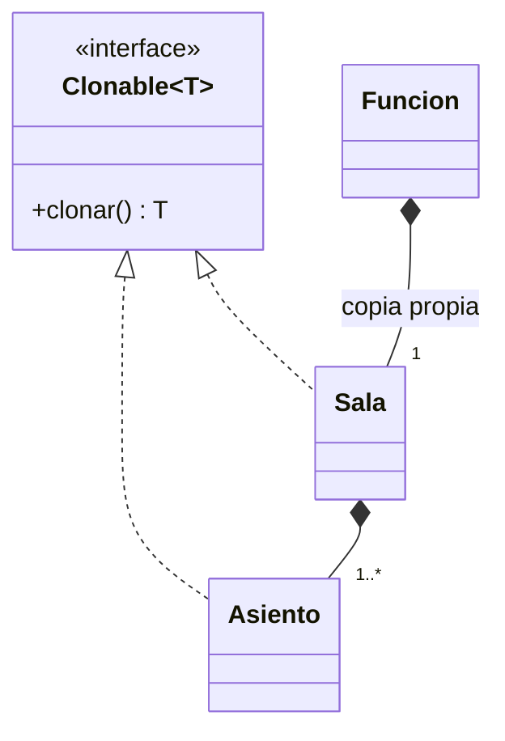

### 6.4 Adapter
- **Problema:** `ServicioCompra` necesita verificar, cobrar y devolver dinero sin depender de cómo funciona la tarjeta virtual.
- **Justificación:** `ServicioCompra` conoce solo la interfaz `MedioPago` (objetivo). `AdaptadorTarjetaVirtual` (adaptador) traduce `verificar`, `cobrar` y `devolver` a `verificarPago`, `descontar` y `reembolsar` de `TarjetaVirtual` (adaptada).
- **Consecuencia:** cada medio nuevo debe cumplir el contrato. `CinemaFacade` instancia directamente el adaptador actual.
- **Evidencia:** `CompraTarjetaVirtualTest`.

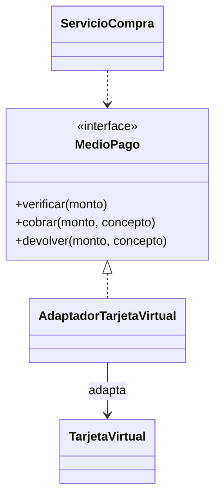

### 6.5 Composite
- **Problema:** el sistema debe tratar igual un producto suelto y un combo al calcular precios. Un combo agrupa productos.
- **Justificación:** `ElementoProducto` (componente) define `calcularPrecio()`. `Producto` (hoja) devuelve su precio. `Combo` (compuesto) suma el de sus elementos y aplica su descuento. El carrito, la compra y los reportes no distinguen uno de otro.
- **Consecuencia:** el cálculo recorre el árbol y aplica el descuento de cada combo. `AgregarProducto` debe evitar ciclos.
- **Evidencia:** `CarritoCompraTest`; reporte *Productos y combos vendidos*.

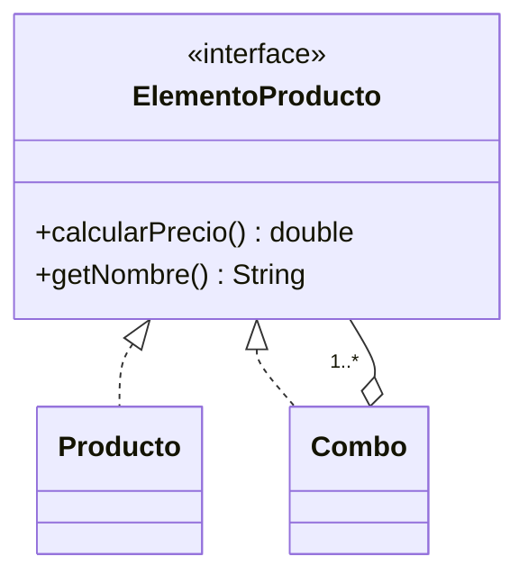

### 6.6 Decorator
- **Problema:** el precio de la entrada depende de los adicionales del formato de la sala (3D, IMAX o ambos).
- **Justificación:** `EntradaBase` tiene la tarifa base. Cada decorador envuelve una `Entrada` y suma su recargo. `ServicioCompra.crearEntrada` arma la cadena según el formato, y una sala IMAX 3D apila los dos. Las tarifas salen de `Tarifario`, que el administrador puede cambiar.
- **Consecuencia:** cada recargo agrega una clase. `crearEntrada()` depende de las etiquetas del formato para armar la cadena.
- **Evidencia:** `SistemaCinemaTest.editarTarifasYProductosNoCambiaComprasAnteriores`; detalle de la entrada en la pantalla de pago.

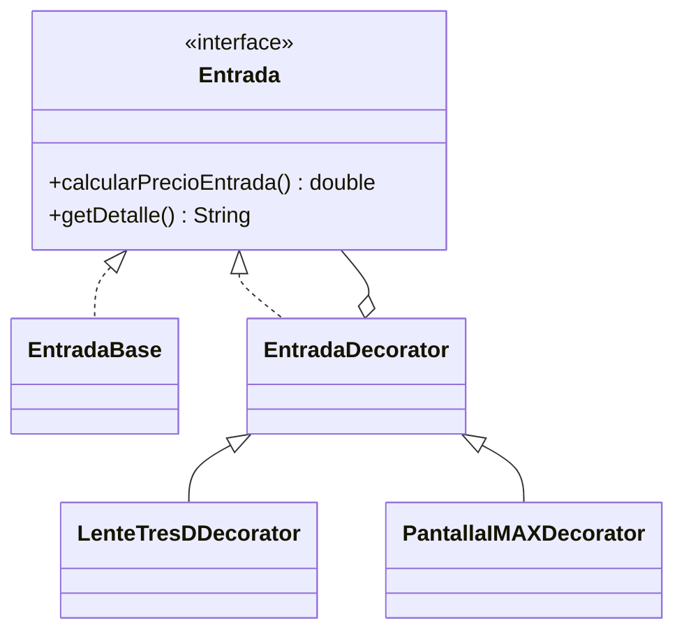

### 6.7 Facade
- **Problema:** para comprar, la interfaz tendría que coordinar la sesión, la validación del carrito, el cálculo del total, el cobro, los asientos, los puntos y el historial.
- **Justificación:** `CinemaFacade` ofrece a los controladores del cliente un acceso único: cartelera, totales, confirmar compra, puntos, cancelar y solicitar recarga. Cada fachada pertenece a una sesión y verifica que siga activa.
- **Consecuencia:** concentra las consultas del cliente y queda acoplada a `ServicioCompra` y al adaptador de la tarjeta.
- **Evidencia:** `SistemaCinemaTest.cerrarSesionRevocaFachadaYNoBorraDatos`; los controladores del cliente solo usan la fachada.

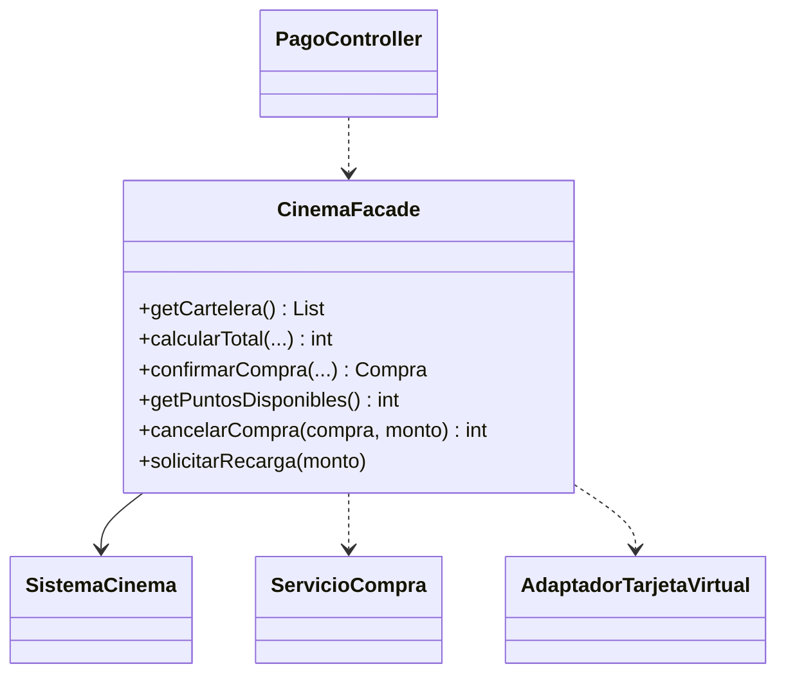

### 6.8 Observer
- **Problema:** el saldo que se ve en la barra superior debe actualizarse cada vez que la tarjeta cambia (compra, recarga aprobada, reembolso), sin que la tarjeta conozca la interfaz.
- **Justificación:** `TarjetaVirtual` (sujeto) mantiene una lista de `ObservadorSaldo` y los avisa en `registrarMovimiento`. `ContextoAplicacion` (observador concreto) se suscribe al entrar el cliente, se retira al cerrar sesión y actualiza la propiedad que muestra `PrincipalController`. El modelo solo conoce la interfaz `ObservadorSaldo`.
- **Consecuencia:** hay que retirar el observador al cerrar la sesión. Un fallo de la pantalla no revierte el movimiento: se registra y se sigue.
- **Evidencia:** `ObservadorSaldoTest`.

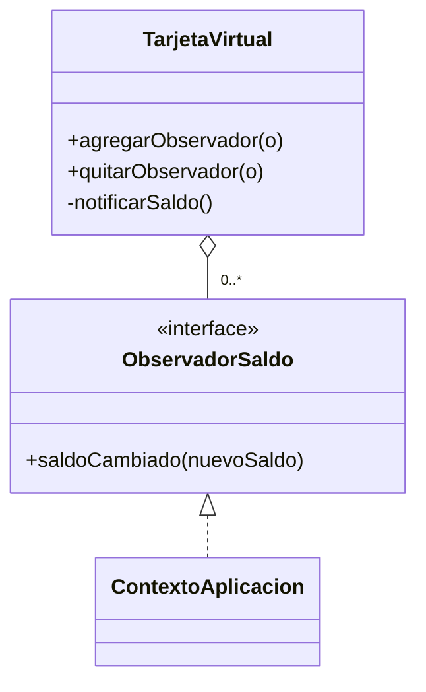

### 6.9 Strategy
- **Problema:** el valor que se devuelve al cancelar depende del tiempo que falta para la función (100 %, 80 % o nada).
- **Justificación:** cada porcentaje es una política que implementa `IPoliticaReembolso.calcularReembolso(total)`. `ServicioCompra` (contexto) elige la política y delega el cálculo. Agregar una política nueva no modifica las existentes. El detalle está en la sección 4.
- **Consecuencia:** cambiar los rangos de tiempo exige editar el selector en `ServicioCompra`.
- **Evidencia:** `SistemaCinemaTest.plazosExactosUsanStateYStrategy`.

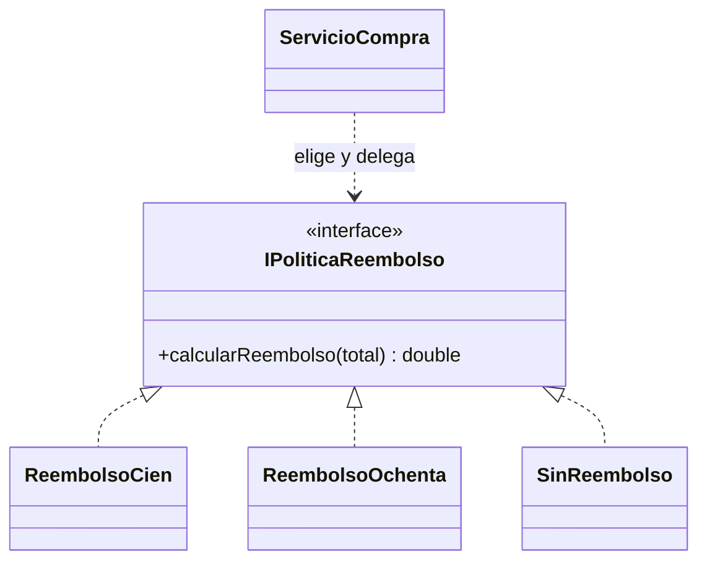

### 6.10 State
- **Problema:** lo que se puede hacer con una compra depende de su estado: una compra confirmada se puede cancelar dentro del plazo; una cancelada no se puede volver a cancelar ni reembolsar.
- **Justificación:** `Compra` (contexto) guarda un `EstadoCompra` y le delega `validarCancelacion`, `cancelar` y `cancelarPorCine`. `CompraConfirmada` valida el plazo y devuelve el nuevo estado. `CompraCancelada` lanza una excepción en todas las operaciones. La regla "nunca reembolsar dos veces" queda garantizada por el estado, sin condicionales repartidos.
- **Consecuencia:** hay una clase por estado, y la compra debe pasar a cancelada solo cuando el reembolso ya se hizo.
- **Evidencia:** `SistemaCinemaTest.cancelarFuncionNoDuplicaReembolsoDeCompraYaCancelada`, `cineCancelaFuncionAlCienInclusoDentroDeDosHoras`.

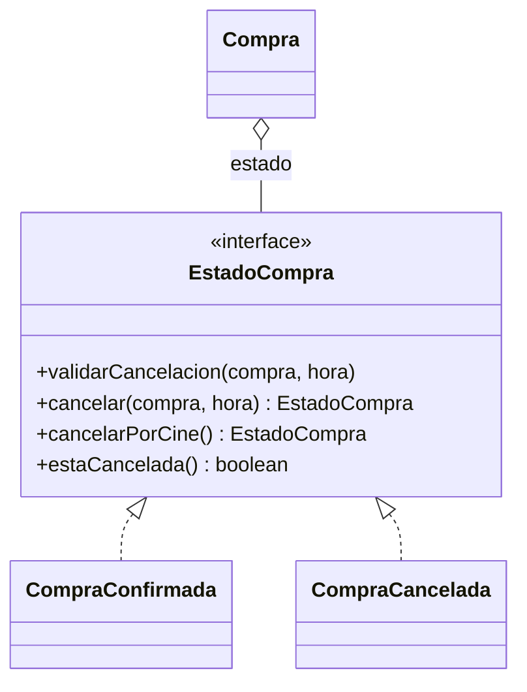

## 7. Principios SOLID con evidencia en el código

### S · Responsabilidad única
Cada clase tiene un solo motivo para cambiar.

| Clase | Su única responsabilidad |
|---|---|
| `MontoPuntos` | Llevar la cuenta de puntos del cliente |
| `LotePuntos` | Una acumulación: cantidad, fecha y vencimiento |
| `SesionesCinema` | Registro de clientes, credenciales y sesión actual |
| `EstadisticasCine` | Calcular estadísticas |
| `ExportadorReporteTxt` | Dar formato de texto a un reporte |
| `ReportesAdminController` | Mostrar: no calcula |

```java
// model/EstadisticasCine.java — calcula; no conoce JavaFX ni archivos
public ResumenEstadistico calcular(LocalDate desde, LocalDate hasta) { ... }

// controller/ReportesAdminController.java — solo dibuja el Map que recibe
private void dibujarBarras(Map<String, Integer> entradasPorPelicula) {
    XYChart.Series<String, Number> serie = new XYChart.Series<>();
    for (Map.Entry<String, Integer> pelicula : entradasPorPelicula.entrySet()) {
        serie.getData().add(new XYChart.Data<>(pelicula.getKey(), pelicula.getValue()));
    }
    ...
}
```

### O · Abierto/cerrado
Se extiende con clases nuevas, sin modificar las existentes.

```java
// service/ExportadorReporte.java
public interface ExportadorReporte {
    String getExtension();
    String formatear(Reporte reporte);
    void exportar(Reporte reporte, Path archivo) throws IOException;
}
```
Para exportar a PDF se crea `ExportadorReportePdf implements ExportadorReporte`. Los reportes y la vista no cambian. Lo mismo ocurre con una política de reembolso nueva (`IPoliticaReembolso`), un recargo nuevo (`EntradaDecorator`) o un estado nuevo de la compra (`EstadoCompra`).

### L · Sustitución de Liskov
Cualquier implementación sirve donde se espera la interfaz.

```java
// service/ServicioCompra.java — Producto y Combo se usan igual
for (ElementoProducto producto : productos) {
    total = total + (int) Math.round(producto.calcularPrecio());
}
```
La prueba `guardaEnHistorialCualquierElementoQueCumplaElContrato` compra un `ElementoProducto` creado en la misma prueba ("Helado") y el sistema lo cobra y lo guarda sin cambios. `ReembolsoCien` y `ReembolsoOchenta` se intercambian en `procesarReembolso`.

### I · Segregación de interfaces
Interfaces pequeñas, cada una con lo que su cliente necesita.

```java
public interface ObservadorSaldo { void saldoCambiado(int nuevoSaldo); }      // 1 método
public interface IPoliticaReembolso { double calcularReembolso(double total); } // 1 método
public interface MedioPago {                                                   // 3 métodos
    void verificar(int monto);
    void cobrar(int monto, String concepto);
    void devolver(int monto, String concepto);
}
```
`ContextoAplicacion` implementa solo `ObservadorSaldo`: no se le obliga a conocer el resto de la tarjeta.

### D · Inversión de dependencias
Las clases de alto nivel dependen de abstracciones.

```java
// service/ServicioCompra.java — recibe la abstracción, no la tarjeta
public Compra comprar(Cliente cliente, Funcion funcion, List<String> asientos,
                      List<ElementoProducto> productos, MedioPago medioPago) { ... }

// model/TarjetaVirtual.java — el modelo avisa a una interfaz, no a la pantalla
private final List<ObservadorSaldo> observadores = new ArrayList<>();
```
`ServicioCompra` no depende de `TarjetaVirtual`, sino de `MedioPago`. `TarjetaVirtual` no depende de JavaFX, sino de `ObservadorSaldo`. `ReportesAdminController` usa el tipo `ExportadorReporte`.

## 8. Reportes y estadísticas

Se implementó el plan de la parte C del taller.

| Plan del taller | Implementación |
|---|---|
| Una clase que calcula, en el modelo y sin JavaFX | `model.EstadisticasCine` → `ResumenEstadistico`: entradas por película, ingresos brutos, ocupación por función y ventas por día |
| Una interfaz de exportador y una clase TXT | `service.ExportadorReporte` y `service.ExportadorReporteTxt` |
| Un gráfico que solo recibe un Map | `ReportesAdminController.dibujarBarras(Map<String, Integer>)`, `dibujarPastel(Map<String, Long>)` y `dibujarLineas(Map<LocalDate, Long>)` |

**Diferencia con el plan:** el exportador recibe un `Reporte` (título, fecha de generación, periodo, registros y totales) en vez del `ResumenEstadistico`. Así el mismo exportador sirve para todos los reportes del enunciado.

**Reportes** (el administrador elige el tipo y el rango de fechas, y exporta a `.txt`):

| Reporte | Contenido |
|---|---|
| Resumen estadístico | Entradas por película, ingresos brutos y ocupación por función |
| Ventas realizadas por periodo | Cada compra con su estado, lo pagado y los puntos usados |
| Entradas vendidas por película y función | Entradas y compras de cada función |
| Ocupación de las salas | Asientos ocupados y capacidad por función |
| Productos y combos vendidos | Unidades y valor por producto |
| Recargas realizadas | Cada recarga aprobada por el administrador |
| Cancelaciones y reembolsos | Motivo, valor pagado, reembolso y porcentaje devuelto |
| Puntos acumulados y redimidos | Por cliente: acumulados, redimidos, vigentes y vencidos |

Ejemplos generados con los datos iniciales: [`reportes-ejemplo/`](reportes-ejemplo/).

**Reportes visuales** (JavaFX):
- líneas: ventas brutas por día;
- barras: entradas vendidas por película;
- pastel: participación de cada película en los ingresos.

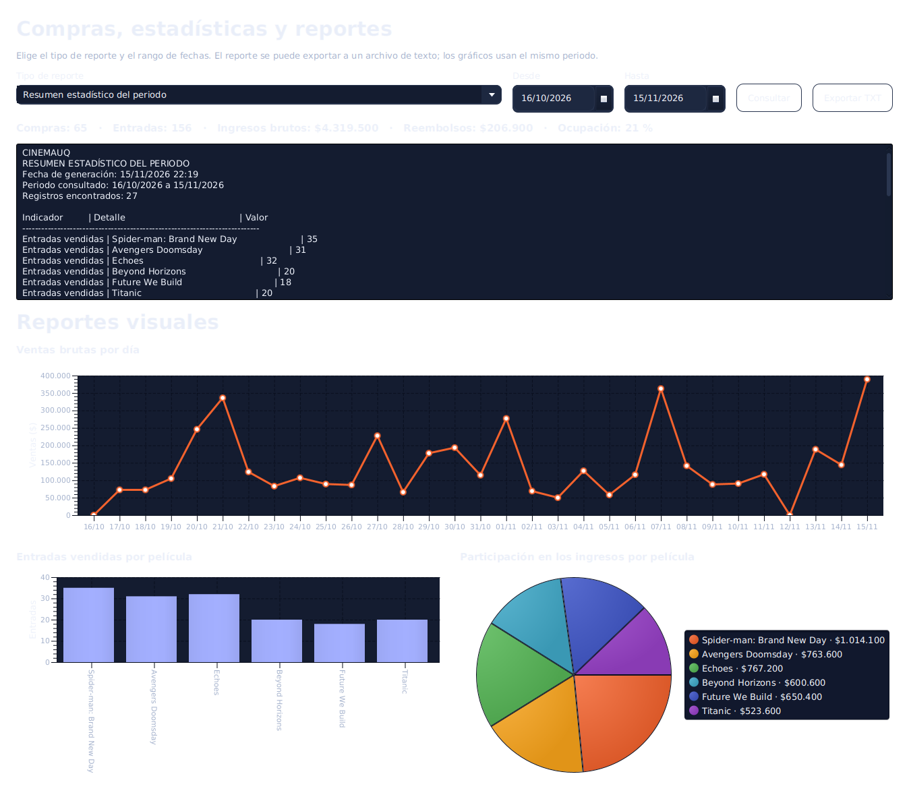

## 9. Datos iniciales

`DatosDemostracion` carga, a través de los mismos servicios de la aplicación:

- 6 películas, 4 salas, 4 productos y 2 combos;
- 25 funciones: 7 en cartelera, 15 del último mes, 2 de hace un año y 1 cancelada por el cine;
- 8 clientes de 16 a 67 años;
- 76 compras con fecha real, algunas pagadas en parte con puntos;
- cancelaciones del cliente con 100 % y con 80 %, y una función cancelada por el cine;
- recargas, y solicitudes de recarga aprobada, rechazada y pendiente;
- puntos vencidos, de las compras de hace 13 meses.

Las compras se generan con una semilla fija, así que siempre salen iguales. `PuntosYReportesTest.losDatosDeDemostracionSonSuficientesParaCadaReporte` comprueba que ningún reporte salga vacío.

## 10. Excepciones propias del dominio

| Excepción | Cuándo se lanza |
|---|---|
| `AsientoOcupadoException` | El asiento ya está vendido en esa función |
| `SaldoInsuficienteException` | La tarjeta no tiene saldo para la compra |
| `TarjetaInactivaException` | La tarjeta está bloqueada |
| `EdadNoPermitidaException` | El cliente no cumple la edad mínima de la película |
| `CompraInvalidaException` | Carrito inválido, función cancelada o iniciada, cancelación fuera de plazo o repetida |
| `PuntosInsuficientesException` | Se intenta redimir más puntos vigentes de los disponibles |

## 11. Pruebas JUnit (53)

| Clase | Pruebas | Qué cubre |
|---|---|---|
| `ConsecutivoFacturaTest` | 2 | Singleton |
| `FuncionBuilderTest` | 4 | Builder |
| `SalaPrototypeTest` | 5 | Prototype |
| `CarritoCompraTest` | 4 | Carrito y Composite |
| `CompraTarjetaVirtualTest` | 6 | Compra, Adapter, tarjeta |
| `ObservadorSaldoTest` | 1 | Observer |
| `SistemaCinemaTest` | 18 | Sesión, administración, State, Strategy, promociones, reporte |
| `PuntosYReportesTest` | 13 | Redención y vigencia de puntos, estadísticas, 8 reportes, exportador, datos iniciales |

## 12. Capturas

| | |
|---|---|
| Acceso | [`01-acceso.png`](img/entrega3/01-acceso.png) |
| Reportes y gráficos | [`02`](img/entrega3/02-reportes.png) · [`03`](img/entrega3/03-reportes-y-graficos.png) · [`04`](img/entrega3/04-reporte-cancelaciones.png) · [`05`](img/entrega3/05-reporte-puntos.png) |
| Clientes y recargas | [`06-clientes-y-recargas.png`](img/entrega3/06-clientes-y-recargas.png) |
| Pago con puntos | [`07-pago-con-puntos.png`](img/entrega3/07-pago-con-puntos.png) |
| Tarjeta y puntos | [`08-tarjeta-y-puntos.png`](img/entrega3/08-tarjeta-y-puntos.png) |
| Mis compras | [`09-mis-compras.png`](img/entrega3/09-mis-compras.png) |

## 13. Diagrama de clases

El diagrama completo está en [`Diagrama de clases CinemaUQ Entrega 3.pdf`](Diagrama%20de%20clases%20CinemaUQ%20Entrega%203.pdf) (16 páginas). El archivo editable es [`Diagrama de clases CinemaUQ Entrega 3.drawio`](Diagrama%20de%20clases%20CinemaUQ%20Entrega%203.drawio).

| Página | Contenido |
|---|---|
| 00 · UML completo | Todas las clases y sus relaciones |
| 02 · Cartelera y salas | Película, sala, asiento, función (Builder, Prototype) |
| 03 · Clientes y compras / 03B · Compra e historial | Cliente, tarjeta, compra, factura (Singleton) |
| 04 · Composite y Decorator | Confitería y entradas |
| 05 · Adapter y Facade | Medio de pago y acceso del cliente |
| 06 · Arranque y navegación JavaFX / 06B · Excepciones | Controladores, vistas y excepciones del dominio |
| 07 · Cuentas, sesión y recargas | Registro, sesión y solicitudes de recarga |
| 08 · Catálogo, tarifas y promociones / 08B · Compras y reportes | Administración del catálogo |
| 09 · Cancelación, State y Strategy | Estados de la compra y políticas de reembolso |
| 10 · Observer y saldo | Aviso del saldo a la interfaz |
| 11 · Panel del administrador | Pestañas y formularios del administrador |
| 12 · Puntos | Acumulación, vigencia y redención |
| 13 · Estadísticas, reportes y exportación | `EstadisticasCine`, reportes y exportador |

## 14. Conclusiones

- CinemaUQ cumple las exigencias de la entrega 3: puntos con vigencia y redención, cancelación con reembolso según el plazo, reportes exportables, reportes visuales y datos iniciales para demostrarlo todo.
- Los 10 patrones responden a problemas concretos del dominio: el consecutivo único de factura, la copia de asientos por función, el precio de la entrada por formato, la confitería con combos, el cobro con la tarjeta, el reembolso según el plazo, los estados de la compra y el aviso del saldo.
- Los principios SOLID se ven en el código: cálculo separado de la vista, extensiones sin modificar clases existentes, interfaces pequeñas y dependencias hacia abstracciones.
- Las 53 pruebas JUnit verifican las reglas de negocio, incluidas las de los patrones de comportamiento.

