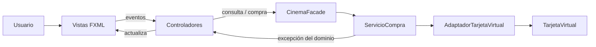
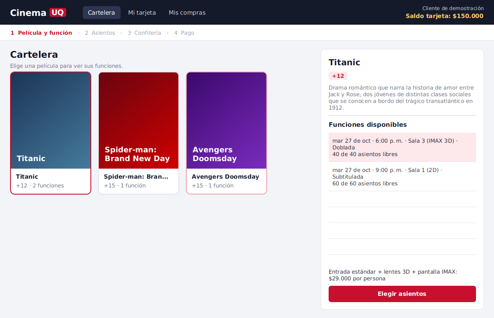
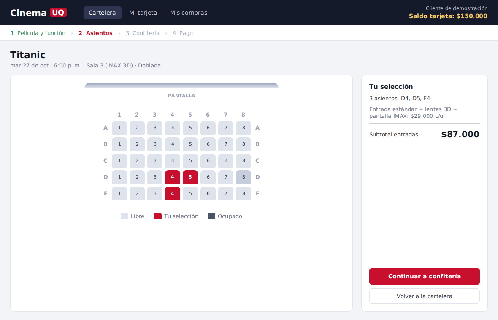
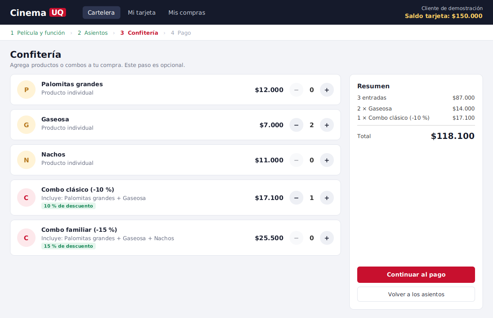
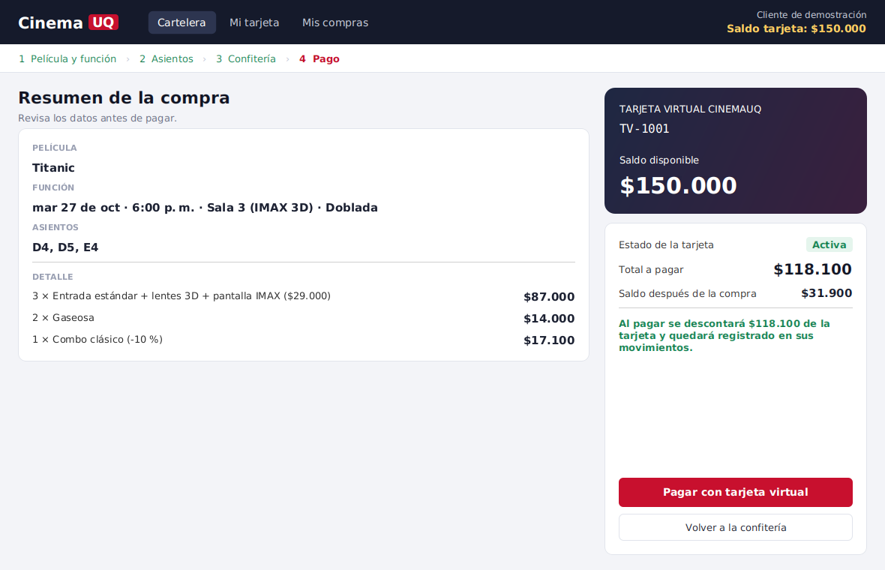
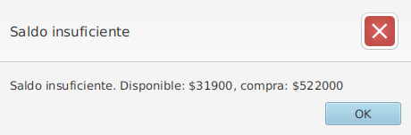
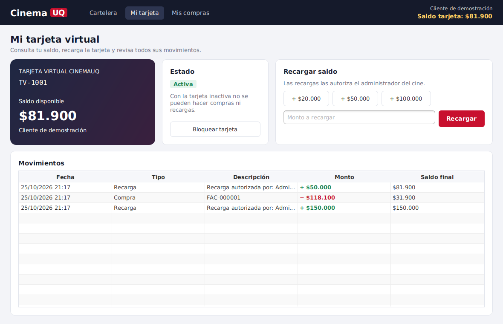
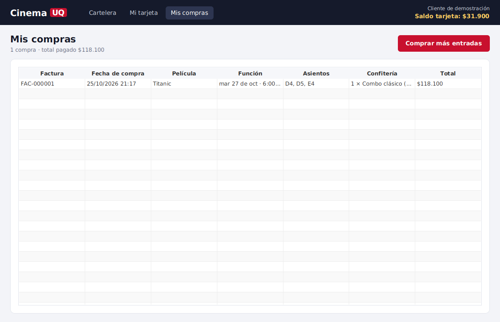

# Interfaz gráfica JavaFX — separación MVC

**Responsable:** Juan Carlos Polanía · **Entrega 2**

## 1. Cómo se aplica MVC

| Capa | Paquete / carpeta | Qué contiene | Regla |
|---|---|---|---|
| **Modelo** | `model`, `service`, `exception` | Dominio (`Pelicula`, `Funcion`, `Sala`, `TarjetaVirtual`, `CarritoCompra`…), servicios (`ServicioCompra`), la fachada `CinemaFacade` y las excepciones propias | No importa nada de JavaFX |
| **Vista** | `resources/com/example/cinemauq/view/*.fxml` y `css/cinemauq.css` | Estructura y estilo de cada pantalla | Sin lógica: solo componentes y su disposición |
| **Controlador** | `controller` | Un controlador por vista: lee lo que el usuario elige, llama a la fachada y muestra el resultado | No calcula precios ni valida reglas de negocio: eso lo hace el modelo |

La interfaz habla con el modelo **solo a través de `CinemaFacade`** (patrón Facade). Los controladores no crean `ServicioCompra` ni `AdaptadorTarjetaVirtual` ni modifican la tarjeta directamente para pagar.

## 2. Clases de la interfaz

| Clase | Responsabilidad |
|---|---|
| `CinemaUQApplication` | Arranca JavaFX: crea la fachada de demostración, carga `principal-view.fxml` y aplica el CSS |
| `Launcher` | `main()` para ejecutar desde IntelliJ |
| `ContextoAplicacion` | Une vistas y modelo: guarda la fachada y el carrito, carga cada FXML en el área central y publica el saldo como propiedad observable |
| `Vista` (enum) | Lista de pantallas y su número de paso en el flujo de compra |
| `Controlador` (interfaz) | Contrato `inicializar(ContextoAplicacion)` que cumplen todos los controladores |
| `PrincipalController` | Barra superior (navegación, cliente y saldo) e indicador de pasos 1-4 |
| `CarteleraController` | Paso 1: películas, funciones y precio de la entrada |
| `AsientosController` | Paso 2: mapa gráfico de la sala con un botón por asiento |
| `ConfiteriaController` | Paso 3: productos y combos con cantidades |
| `PagoController` | Paso 4: resumen y pago con la tarjeta virtual |
| `TarjetaController` | Saldo, estado, recarga y movimientos de la tarjeta |
| `ComprasController` | Historial de compras confirmadas |
| `Alertas` | Muestra las excepciones del dominio en diálogos, con un título según el tipo |
| `Formato` | Formato de moneda (pesos colombianos) y de fechas |
| `model.CarritoCompra` | Compra en curso: película, función, asientos y productos. Conserva la selección al ir y volver entre pantallas |

## 3. Requisitos de la entrega cubiertos por la interfaz

| Exigencia | Dónde | Cómo |
|---|---|---|
| Cartelera | `cartelera-view.fxml` | Tarjetas de película con clasificación y número de funciones; panel con descripción, funciones (fecha, sala, formato, idioma, asientos libres) y precio de la entrada |
| Selección gráfica de asientos | `asientos-view.fxml` | Matriz de la sala con filas A, B, C… y columnas numeradas. Libre / seleccionado / ocupado con colores distintos; los ocupados están deshabilitados (RN-002) |
| Confitería | `confiteria-view.fxml` | Productos y combos en la misma lista, con botones − / +. El total lo calcula el modelo (`calcularTotal`) |
| Compra | `pago-view.fxml` | Resumen completo y botón de pago; al confirmar se muestra la factura con su consecutivo |
| Tarjeta virtual: verificación de saldo | Pago | Aviso previo si el saldo no alcanza; al pagar, el modelo verifica y lanza `SaldoInsuficienteException` |
| Tarjeta virtual: descuento | Pago → `ServicioCompra` | El modelo descuenta el total solo si el pago se aprueba |
| Tarjeta virtual: registro de movimientos | `tarjeta-view.fxml` | Tabla de movimientos (compra, recarga, reembolso) con monto y saldo final |
| Excepciones propias del dominio | `Alertas` | `SaldoInsuficienteException`, `TarjetaInactivaException`, `AsientoOcupadoException`, `EdadNoPermitidaException` y `CompraInvalidaException` se muestran con un título propio |

## 4. Cómo se ven los patrones estructurales en la interfaz

| Patrón | Dónde se nota en la interfaz |
|---|---|
| **Facade** (`CinemaFacade`) | Es la única puerta de los controladores al modelo |
| **Composite** (`ElementoProducto`, `Producto`, `Combo`) | La confitería lista productos y combos igual y obtiene su precio con `calcularPrecio()` sin distinguirlos |
| **Decorator** (`Entrada`, `LenteTresDDecorator`, `PantallaIMAXDecorator`) | El precio y el detalle de la entrada cambian según el formato de la sala: 2D $18.000, 3D $22.000, IMAX 3D $29.000 |
| **Adapter** (`MedioPago`, `AdaptadorTarjetaVirtual`) | Al pagar, `ServicioCompra` cobra a través de `MedioPago`; la vista no sabe que detrás está la tarjeta virtual |

## 5. Capturas

**Paso 1 · Cartelera**

**Paso 2 · Selección de asientos**

**Paso 3 · Confitería**

**Paso 4 · Pago con tarjeta virtual**

**Excepción del dominio: saldo insuficiente**

**Tarjeta virtual: saldo, recarga y movimientos**

**Mis compras**

## 6. Evidencia (pruebas JUnit)

| Clase | Qué demuestra |
|---|---|
| `service/CompraTarjetaVirtualTest` | La compra descuenta el saldo y registra el movimiento con la factura; el saldo insuficiente y la tarjeta inactiva rechazan la compra sin tocar el saldo; un asiento vendido no se vuelve a vender; la recarga suma y queda registrada |
| `model/CarritoCompraTest` | Selección y deselección de asientos, cambio de función, cantidades de confitería y vaciado del carrito |

## 7. Preguntas probables en la sustentación

- **¿Dónde está la lógica de negocio?** En el modelo. Por ejemplo, `PagoController.pagar()` solo llama a `fachada.confirmarCompra(...)` y muestra el resultado o el error.
- **¿Por qué `ContextoAplicacion`?** Para no repetir en cada controlador cómo cargar un FXML, y para que todos compartan la misma fachada y el mismo carrito sin variables estáticas.
- **¿Cómo se impide vender un asiento ocupado?** Dos barreras: la vista deshabilita el botón, y aunque se intentara, `ServicioCompra` verifica cada asiento y lanza `AsientoOcupadoException` antes de cobrar.
- **¿Por qué el saldo de la barra superior se actualiza solo?** Es una `IntegerProperty` observable en `ContextoAplicacion`; `PrincipalController` la escucha.
